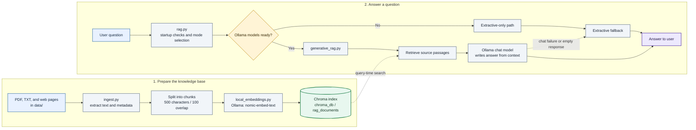
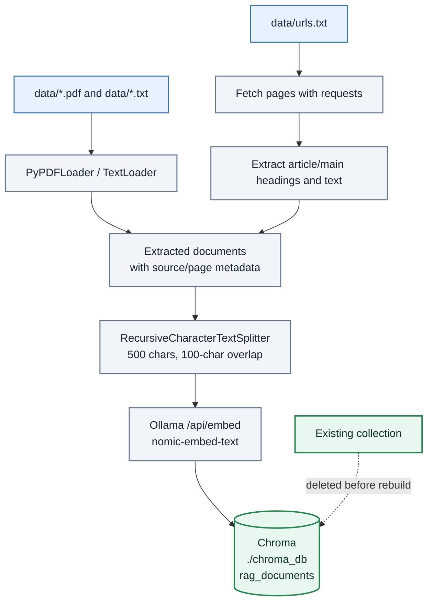
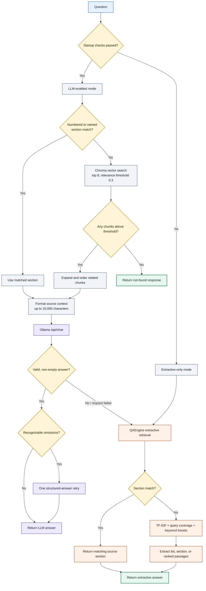

# Local RAG POC

A local Retrieval-Augmented Generation (RAG) proof of concept using Python, Ollama, LangChain, and Chroma. It ingests PDF and text files plus web pages, retrieves passages related to a question, and answers with a local chat model. If chat generation is unavailable or fails, it can use a local extractive answer path.

> This is a learning project, not a production-ready service. Retrieval and answer completeness depend on the source text, chunk boundaries, retrieval ranking, and capabilities of the selected model.

## How RAG works in this project

### End-to-end architecture



### Ingestion and indexing

This is a separate command from asking questions. It reads the source data, creates vectors, then rebuilds the local Chroma collection.



### Question retrieval, generation, and fallback

The LLM path first looks for a matching heading. If that fails, it uses vector similarity. Extractive fallback uses the same indexed source text but ranks it with TF-IDF rather than the embedding vectors.



### Pipeline stages

1. **Ingestion and extraction** — `ingest.py` reads supported files from `data/`. PDFs are loaded page by page. Text files are loaded and short colon-ended labels are retained as section metadata. URLs are read from `data/urls.txt`; the HTML parser collects headings and text from article/main content.
2. **Chunking** — the extracted documents are divided into chunks of 500 characters with 100 characters of overlap. The overlap helps retain context at chunk boundaries. These settings are in `ingest.py`; they are character counts, not token counts.
3. **Embedding and indexing** — `local_embeddings.py` calls Ollama's embedding API with `nomic-embed-text` by default. Chroma stores each chunk, its vector, and source metadata in `./chroma_db`, in the `rag_documents` collection. Running `ingest.py` deletes and rebuilds that collection.
4. **Retrieval** — `generative_rag.py` first tries numbered/named section matching through `QAEngine`. If it does not find a matching section, it asks Chroma for up to 8 vector-similar chunks and applies a relevance threshold of 0.3. Related chunks may be added to provide a fuller section.
5. **Generation** — `generative_rag.py` formats retrieved text and sends it with the question to Ollama's `/api/chat` endpoint. The prompt instructs the model to answer from the supplied context, preserve lists, and avoid inventing unsupported details. The default chat settings use a 4096-token context and allow up to 512 generated tokens for the main response.
6. **Completeness retry and fallback** — the code checks certain recognizable list, subsection, example, and conclusion patterns and may make one additional LLM request if the first answer appears incomplete. If chat fails, returns invalid JSON, or returns an empty answer, it uses the extractive path. If retrieval returns no context, it returns a not-found message without calling the extractive fallback.
7. **Extractive retrieval** — `qa_engine.py` first tries section matching. Otherwise it ranks chunks using local TF-IDF plus query-term and keyword scores, then returns matched text, selected lists, or passages. This does not use `nomic-embed-text`; the embeddings are used by Chroma vector retrieval.

## Project files

| File | Purpose |
| --- | --- |
| `ingest.py` | Loads PDFs, text files, and configured URLs; chunks the text; embeds it; and rebuilds the Chroma collection. |
| `rag.py` | Main interactive command-line application; opens Chroma, checks Ollama/model availability, and selects LLM or extractive-only startup mode. |
| `generative_rag.py` | Coordinates section/vector retrieval, prompt construction, Ollama chat, follow-up handling, completeness retry, and runtime extractive fallback. |
| `qa_engine.py` | Section matching, TF-IDF retrieval, and extractive answer construction. |
| `local_embeddings.py` | LangChain embedding adapter that sends document/query text to Ollama. |
| `rag_config.py` | Shared Chroma directory, collection name, and Ollama defaults. |
| `ssl_bootstrap.py` | Configures Python HTTP certificate trust; imported by the app and ingestion scripts for its initialization side effect. |
| `ask.py` | Interactive diagnostic that prints the top 3 raw Chroma similarity-search results; it does not call the chat model. |
| `debug_retrieval.py` | One-question diagnostic that prints the top 5 raw Chroma results with metadata and content. |
| `requirements.txt` | Pinned Python packages used by the project. |
| `.gitignore` | Excludes the local Python environment, generated Chroma index, Python caches, and local data files from Git. |

## Requirements

- Windows, macOS, or Linux
- Python 3.10 or later (Python 3.11 is recommended)
- [Git](https://git-scm.com/downloads), if cloning or publishing the repository
- [Ollama](https://ollama.com/download) installed and running locally
- Ollama models:
  - Chat: `qwen2.5:0.5b` (default; overridable with `OLLAMA_MODEL`)
  - Embeddings: `nomic-embed-text` (default; overridable with `OLLAMA_EMBEDDING_MODEL`)

The Python libraries are declared in `requirements.txt`. The app also requires Ollama and the model weights; `pip install` does not install Ollama or its models.

## Setup on Windows (PowerShell)

Run these commands from the repository root:

```powershell
# Create and activate a virtual environment
py -m venv venv
.\venv\Scripts\Activate.ps1

# Upgrade pip and install the pinned Python dependencies
python -m pip install --upgrade pip
python -m pip install -r requirements.txt

# Create the local input directory and an optional URL list file
New-Item -ItemType Directory -Force data
if (-not (Test-Path .\data\urls.txt)) { New-Item -ItemType File .\data\urls.txt }
```

If PowerShell blocks activation scripts, allow activation only for the current PowerShell process, then activate:

```powershell
Set-ExecutionPolicy -Scope Process -ExecutionPolicy Bypass
.\venv\Scripts\Activate.ps1
```

You can also avoid activation and invoke the environment's Python directly:

```powershell
.\venv\Scripts\python.exe -m pip install -r requirements.txt
```

### Install and prepare Ollama models

Install Ollama using its official installer, then open a new PowerShell window. If Ollama is not already running as a desktop service, start its server in a separate window:

```powershell
ollama serve
```

In another PowerShell window, download the required models:

```powershell
ollama pull qwen2.5:0.5b
ollama pull nomic-embed-text
ollama list
```

The first download can take time. Keep Ollama running when using the app or ingesting documents.

### Add your documents

Put PDF and `.txt` files in the `data` folder. For example, copy a PDF into it:

```powershell
Copy-Item "C:\Path\To\Your\Document.pdf" .\data\
```

To ingest web pages, put one URL per line in `data\urls.txt`; lines starting with `#` are ignored:

```powershell
@'
https://example.com/article
# https://example.com/another-article
'@ | Set-Content .\data\urls.txt
```

The current loader selects files ending in lowercase `.pdf` and `.txt`. The URL extractor is designed for pages that expose their main content under HTML `article` or `main` elements, so some websites may not yield usable text.

## Run the application

From the repository root with the virtual environment active:

```powershell
# Extract sources, chunk text, create embeddings, and rebuild Chroma
python ingest.py

# Start the interactive RAG question-answering loop
python rag.py
```

Ask questions at the `Question:` prompt. Use `Ctrl+C` to stop either interactive diagnostic or the app.

Ingestion is required before the first question-answering run and again whenever you want to rebuild the index from changed documents. **It deletes and recreates the configured Chroma collection**, so it is not an incremental update. Keep original files backed up separately; the Chroma index is generated data.

## Optional diagnostics

Run these from the repository root after ingestion:

```powershell
# Show the top 3 raw Chroma results repeatedly
python ask.py

# Show the top 5 raw Chroma results, with metadata, for one question
python debug_retrieval.py
```

These scripts help check which raw chunks vector search finds. They do not run the full application section-matching logic or generate an LLM answer.

## Configuration

Defaults are in `rag_config.py` and can be overridden with environment variables:

| Variable | Default | Description |
| --- | --- | --- |
| `OLLAMA_MODEL` | `qwen2.5:0.5b` | Ollama chat model. For example, set `OLLAMA_MODEL=qwen2.5:3b` to test another installed model. |
| `OLLAMA_EMBEDDING_MODEL` | `nomic-embed-text` | Ollama embedding model. Use the same embedding model for ingestion and querying. |
| `OLLAMA_BASE_URL` | `http://127.0.0.1:11434` | Ollama API address. |

Example PowerShell commands for changing settings in the current window:

```powershell
$env:OLLAMA_MODEL = "qwen2.5:3b"
python rag.py
```

These environment-variable assignments apply only to that PowerShell window. The chat model can be changed without re-ingesting, but changing the embedding model requires rebuilding the index with that same model before querying.

## Python imports and installing dependencies

Project Python files import standard-library modules such as `os`, `logging`, `re`, and `html.parser`, plus third-party packages including:

- `requests`
- `langchain-community`, `langchain-core`, and `langchain-text-splitters`
- `chromadb`
- `scikit-learn`
- `pypdf`
- `truststore`

Install the complete pinned dependency set with:

```powershell
python -m pip install -r requirements.txt
```

This installs transitive dependencies too. You generally should not install each import individually. If you are adding a new import to the project, add its package to `requirements.txt` as appropriate, then install the updated requirements. Ollama and its models are separate system dependencies.

## Local/generated files and Git

The project `.gitignore` intentionally keeps local/generated content out of Git:

```gitignore
venv/
.venv/
__pycache__/
*.py[cod]
chroma_db/
data/*
!data/.gitkeep
.env
.env.*
!.env.example
Thumbs.db
```

- **`venv/` and `.venv/`** — local Python packages; recreate them with `py -m venv venv` and install from `requirements.txt`.
- **`__pycache__/` and `*.pyc`** — Python-generated bytecode caches; Python recreates these automatically.
- **`chroma_db/`** — generated local vector database; `python ingest.py` creates/rebuilds it.
- **`data/*`** — local source documents and URL lists; create `data/`, then add your own sources. `data/.gitkeep` is only an empty placeholder to preserve the directory in Git. Do not commit private or copyrighted source documents unless you have the right to share them.

Create the input directory and placeholder file if needed:

```powershell
New-Item -ItemType Directory -Force data
New-Item -ItemType File -Force data\.gitkeep
```

If any of these paths were already committed before adding `.gitignore`, Git continues tracking them. To stop tracking them while keeping local copies, run:

```powershell
git rm -r --cached --ignore-unmatch -- venv .venv __pycache__ chroma_db data
git add .gitignore
git status --short
```

Review the staged changes before committing. The command removes these paths from the Git index; `--cached` keeps the local files on disk. Because `data/*` is ignored, only `data/.gitkeep` can be added as a placeholder:

```powershell
git add data/.gitkeep
```

## Troubleshooting

- **Ollama unavailable:** Start the Ollama app or run `ollama serve`; verify with `ollama list`.
- **Model missing:** Run `ollama pull qwen2.5:0.5b` and `ollama pull nomic-embed-text`, or confirm your configured model names.
- **No indexed sources:** Put supported files in `data/` and run `python ingest.py` from the repository root.
- **Incorrect or irrelevant answer:** Use `python debug_retrieval.py` to inspect raw Chroma results. The answer generator can only use the context it receives; poor retrieval, extraction, or chunking can result in a poor answer.
- **Different embedding model:** Use the same `OLLAMA_EMBEDDING_MODEL` value for ingestion and query time, then rerun ingestion to rebuild vectors.
- **Import errors:** Confirm the virtual environment is active and run `python -m pip install -r requirements.txt`.


## License and Permissions

Copyright (c) 2026 [S Sinchana]. All rights reserved.

This repository is provided for viewing and evaluation only. No permission is
granted to use, copy, modify, distribute, sublicense, or create derivative
works from this code without prior written permission from the copyright
holder.

To request permission, contact: [sinchana.amin1222@gmail.com].

The documents or other source materials used with this project may have
separate owners and terms. This notice does not grant permission to use or
redistribute those materials.
